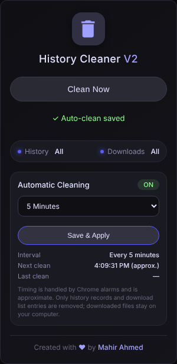
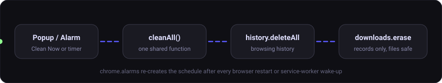

<div align="center">



<br>


<a href="https://github.com/Mahir966"></a>

</div>

---

## ✨ Features

| | Feature | Details |
|---|---|---|
| 🧹 | **Clean Now** | One click clears all browsing history and download records |
| ⏱️ | **Automatic Cleaning** | 12 presets (1 second → 2 hours) plus a custom interval |
| 🔁 | **Survives restarts** | Settings are saved and the schedule is restored after Chrome restarts |
| 🛡️ | **Files stay safe** | Only download *records* are erased, never your actual files |
| 🪶 | **Lightweight** | Vanilla HTML/CSS/JS, no frameworks, no network requests |
| 🌙 | **Dark UI** | Compact popup with a soft indigo accent |

<div align="center">

</div>

## ⚙️ How it works



Manual and automatic cleaning share **one** `cleanAll()` function. Overlapping runs are blocked, and success is reported only after both operations complete.

## 🚀 Installation

1. Download or clone this repository
   ```bash
   git clone https://github.com/Mahir966/History-Cleaner-V2.git
   ```
2. Open `chrome://extensions` and enable **Developer mode**
3. Click **Load unpacked** and select the project folder
4. Pin the extension to your toolbar

## ⏲️ Automatic cleaning

1. Open the popup → **Automatic Cleaning**
2. Choose an interval and click **Save & Apply**
3. The first clean runs after one full interval, then repeats, even with the popup closed

**Custom interval:** choose *Custom*, enter a positive number, pick Seconds / Minutes / Hours. Zero, negative, invalid and values over 7 days are rejected.

**Turn off:** choose *Off (Manual Only)* and Save & Apply.

> [!NOTE]
> Scheduling uses `chrome.alarms`, which is approximate. Intervals under 30 seconds work in unpacked (developer-mode) installs; Chrome enforces a 30-second minimum for packed/Web Store extensions. If the computer sleeps, missed cleans run once Chrome is active again.

## 🔐 Permissions

| Permission | Why |
|---|---|
| `history` | `history.deleteAll()` clears browsing history |
| `downloads` | `downloads.erase({})` clears download records (not files) |
| `alarms` | Reliable scheduling that survives service-worker suspension |
| `storage` | Saves your interval and schedule state locally |

## 📁 Project structure

```
History_Cleaner_V2/
├── manifest.json
├── background.js     # cleanAll(), alarms, state
├── popup.html / popup.js
├── icons/            # 16, 48, 128 px
└── assets/           # README visuals
```

## 👤 Author

Created with 💜 by **[Mahir Ahmed](https://mahir966.github.io/ME/)**
